<p align="center"></p>

<h1 align="center">ComfyUI Model Librarian</h1>

<p align="center"><b>Every model in its place — found, fetched, sorted and kept in sync across ComfyUI, LoRA Manager and Stability Matrix.</b></p>

<p align="center">
  <a href="https://github.com/EY4O/ComfyUI-Model-Librarian/blob/main/LICENSE"></a>
  <a href="https://github.com/EY4O/ComfyUI-Model-Librarian/commits/main"></a>
  <a href="https://github.com/EY4O/ComfyUI-Model-Librarian/actions/workflows/tests.yml"></a>
  <a href="https://registry.comfy.org/nodes/comfyui-model-librarian"></a>
  <a href="https://ko-fi.com/looneth"></a>
</p>

A model manager for ComfyUI built around a **shared models folder** — Stability Matrix's, or the one Comfy Desktop uses — and designed to work hand in hand with **[LoRA Manager](https://github.com/willmiao/ComfyUI-Lora-Manager)**. It finds and downloads whatever a workflow is missing, files your models by base model, turns images into recipes, keeps the SSD for the models you actually use — and makes Stability Matrix and LoRA Manager share what they know. Open it from **Library** in the ComfyUI toolbar.

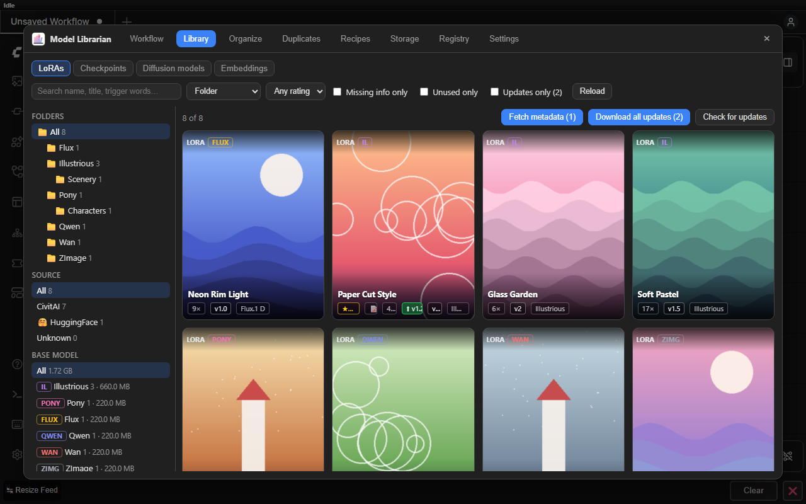

> **⚠ CivitAI downloads and metadata lookups** need your CivitAI API key (civitai.com → Account settings → API Keys). Add it in **Settings** — it's stored server-side and never sent to the browser. Gated HuggingFace models (e.g. FLUX.1-dev) need a HuggingFace token too.

---

## ✨ Key Features

- 🔍 **Missing-model finder** — scans the open workflow (subgraphs, rgthree and LoRA Manager nodes included) and finds sources in order of trust: links embedded in the workflow → your download history → the official links in ComfyUI's own workflow templates → ComfyUI-Manager's list → HuggingFace → CivitAI → [CivArchive](https://civarchive.com) (only for files CivitAI doesn't have). Downloads are SHA256-verified, resume after interruptions and survive restarts.
- 📤 **Share a workflow with its models** — every model gets its download link and SHA256: embed them in the workflow (ComfyUI's own missing-models dialog offers them too), save a copy with them, or copy a ready-to-post model list.
- 🩺 **Workflow health** — checks every saved workflow (and subgraph blueprint) at once: which ones are missing models, which models moved, and one click to find and download them all. Saved files keep working without edits.
- 🖼️ **Library** — a gallery of your models with CivitAI previews, base-model badges, trigger words, search, size per base model and an **Unused** filter. Sort by **most used** or recently used, rate models, and keep your own notes and tags on them. Models from HuggingFace show their license, tags and model card.
- ⬆️ **Update alerts** — a daily check for newer CivitAI versions of every model type, with a badge on the card, an **Updates only** filter and **Download all updates**. Compare a new version with yours first (changelog, size, trigger words, sample images); the old versions are kept, or moved to the archive drive in one click.
- 🗄️ **Removed models** — the same check notices models taken down from CivitAI (or HuggingFace) and marks them, since your copy may be the only one left. Their details are looked up on CivArchive, which also knows of surviving copies to share or download.
- 🗂️ **Base-model organizer** — sorts models into `Illustrious/`, `Pony/`, `Flux/`, `Qwen/` … using CivitAI data, LoRA training metadata and the tensor layout itself. Preview first, undo anytime, and saved workflows are repointed automatically.
- 🧬 **Recipes from images and videos** — drop an image or a ComfyUI video (MP4 / WebM), or paste a link (CivitAI image, video or post, or any image file) to see its prompt, settings, checkpoint and LoRAs with their strengths. After a run, save what made your own image as a recipe from the node's right-click menu or the Workflow tab. Save it to your recipe library, download everything you're missing (a model you have under another name is matched, or linked by hand once), then fill the open workflow with it or open it as a new one. Reads ComfyUI, A1111/Forge, CivitAI, Fooocus, InvokeAI, SwarmUI and NovelAI images; no LoRA Manager needed (with LM installed, recipes are saved there too).
- 🗃️ **Archive a folder of images** — keep what made every image without keeping the images: point it at a folder (subfolders included) and get a report grouped by prompt, where prompts that differ by a few words become variants of one family, plus a CSV, every recipe, one workflow per prompt variant and small WebP thumbnails that carry their image's workflow — drop one onto ComfyUI to get that exact image back, or click one to open it as a recipe. Re-runs only read new images, and the originals can then move to another drive (logged, undoable) while staying in the archive.
- 🔗 **Stability Matrix ↔ LoRA Manager** — understands LM's loader nodes, writes SM's own metadata so models show as *connected*, syncs metadata between the two offline, and tells LM to rescan after every change.
- 💾 **SSD / HDD storage tiers** — models unused for a while are suggested for an archive drive, stay usable under the same names, and come back to the SSD after a workflow uses them. Set a free-space goal and the least recently used models are suggested whenever the SSD runs low; a history chart shows free space on each drive over time.
- ♻️ **Duplicates and leftovers** — finds byte-identical copies under any name (quarantine them or replace them with hard links so every path keeps working), plus unfinished downloads from any app and model files that were cut short.
- 🧹 **Arrange** — right-click the canvas for **Arrange workflow** (or **Arrange N selected nodes**): **Tidy in place** lines up a crowded, spread-out workflow (columns aligned, overlaps and big gaps gone, wires straightened, groups kept, pinned nodes left alone); **Rebuild from connections** lays it out again from its wires, left to right, and shows you the new layout before anything moves. Ctrl+Z undoes either.
- 🎚️ **LoRAs in your workflow** — each LoRA's trigger words, with the ones missing from the positive prompt highlighted and added in one click; **Compare strengths** opens a copy of the workflow that renders the same prompt and seed at several strengths side by side (0 is without the LoRA).
- 🏷️ **Gallery Info node** — tags what a workflow makes for [Model Librarian Gallery](https://github.com/EY4O/Model-Librarian-Gallery): albums, tags, characters, a project, a rating and a note go into every image and video the save node writes, and a folder pattern (`{project}/{character}/{date}/`) can save each file straight into its folder.
- 👤 **Character Select node** — pick one of your characters (the ones the [Model Librarian Chrome extension](https://chromewebstore.google.com/detail/model-librarian/dnopofnpaeindcbbgfhfjkbnjmmjjkcc) adds from Danbooru and other boorus) from a searchable list with their pictures, choose an outfit and click any tag to leave it out: out comes the prompt, the name for Gallery Info, and the character's LoRA when you wire the model through.
- 📚 **Example workflows** — four ready-made workflows in ComfyUI's **Templates** browser, under **comfyui-model-librarian**: **Character Portrait**, **Random Character Batch**, **Hires Character Portrait** and **Gallery Info Starter**, built for Illustrious XL v2.0. Their models carry download links, so a fresh install fetches what they need in one click.
- 🎛️ **VRAM advice** — models too big for your GPU get fp8 and GGUF alternatives, with one-click download and swap.
- 🤝 **Shared across installs** — every ComfyUI using the same models folder (Stability Matrix packages, Comfy Desktop, a standalone ComfyUI) shares one registry, hash cache, history and usage data.

## 🎬 See it in action

**A workflow needs models you don't have** — find every source at once, download them verified into the right folders, and repoint a model that moved.


**Every saved workflow, checked at once** — see which ones are missing models, fetch them under the names the workflows use, and repoint moved models in the saved files.

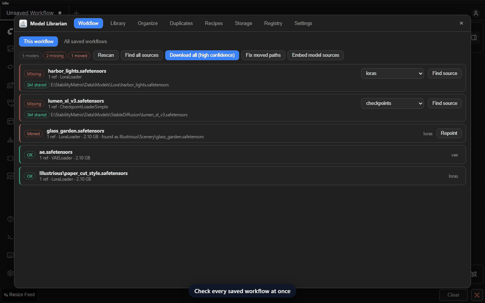

**A recipe from any AI image** — drop it in to see the prompt, settings and every model it used; save it and download what's missing.

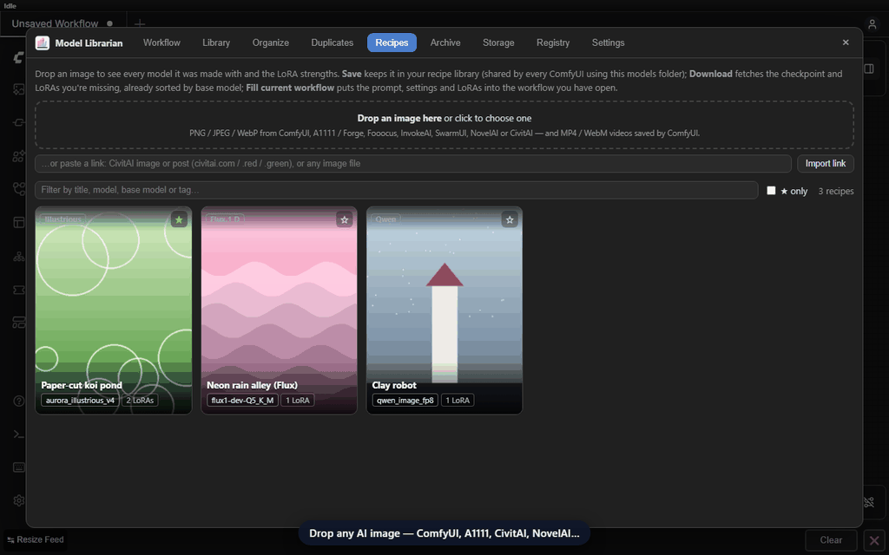

**Update alerts** — newer CivitAI versions download next to the old ones, which can then move to the archive drive.


## 📸 Screenshots

| | |
|---|---|
| 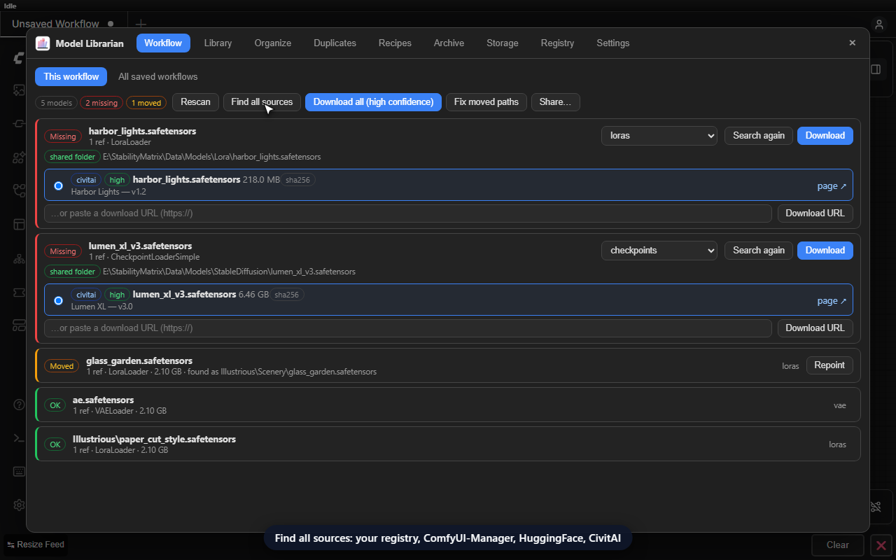 **Workflow** — missing, moved and too-big models with sources and smaller versions | 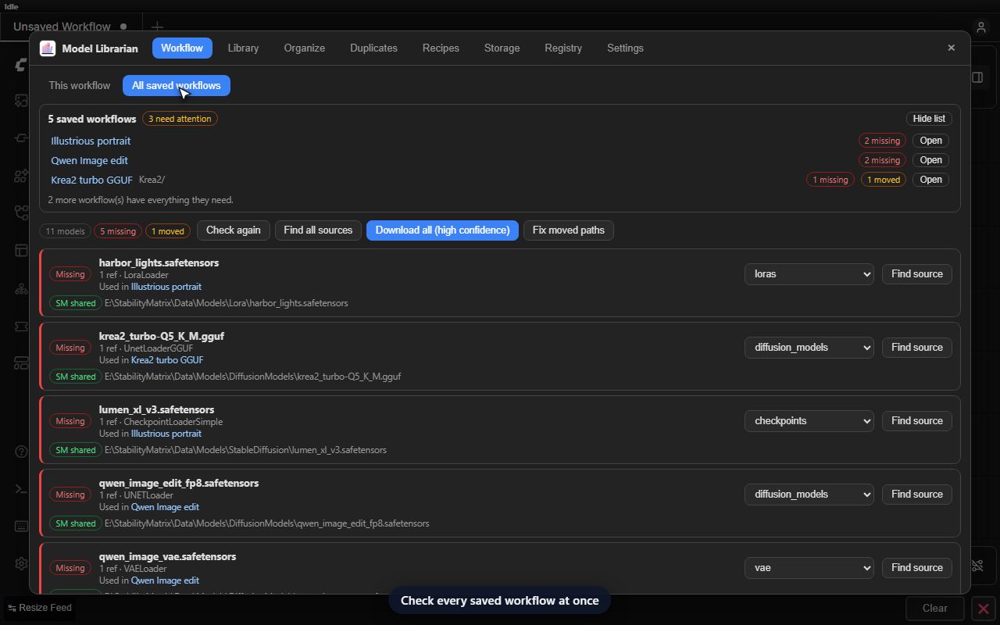 **All saved workflows** — which ones need models, at a glance |
|  **Library** — previews, base-model badges, update alerts and source filters | 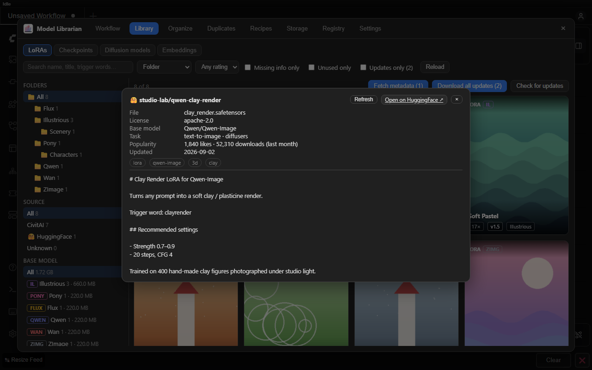 **HuggingFace details** — license, base model, tags and model card |
| 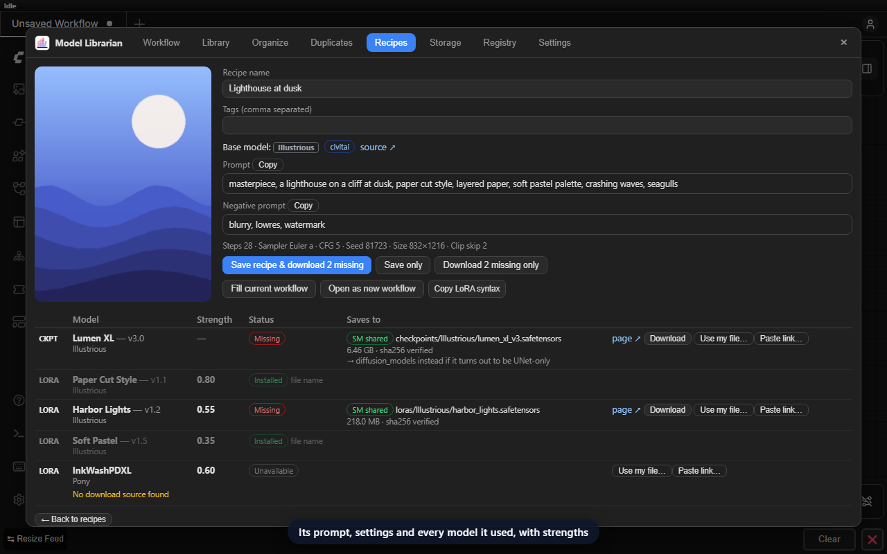 **Recipes** — every model an image used, with strengths, ready to download and apply | 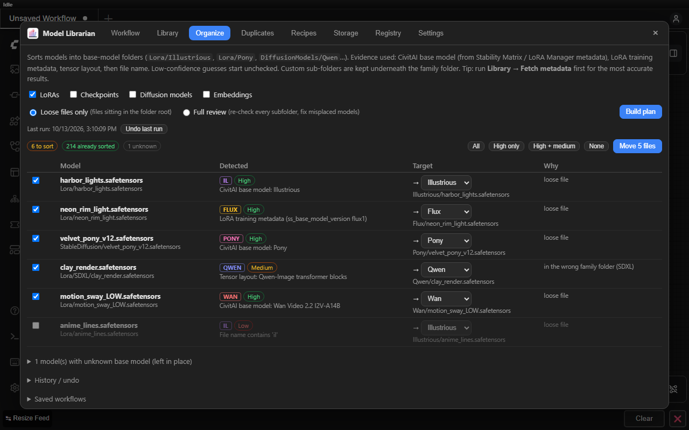 **Organize** — base-model sorting with evidence and confidence |
| 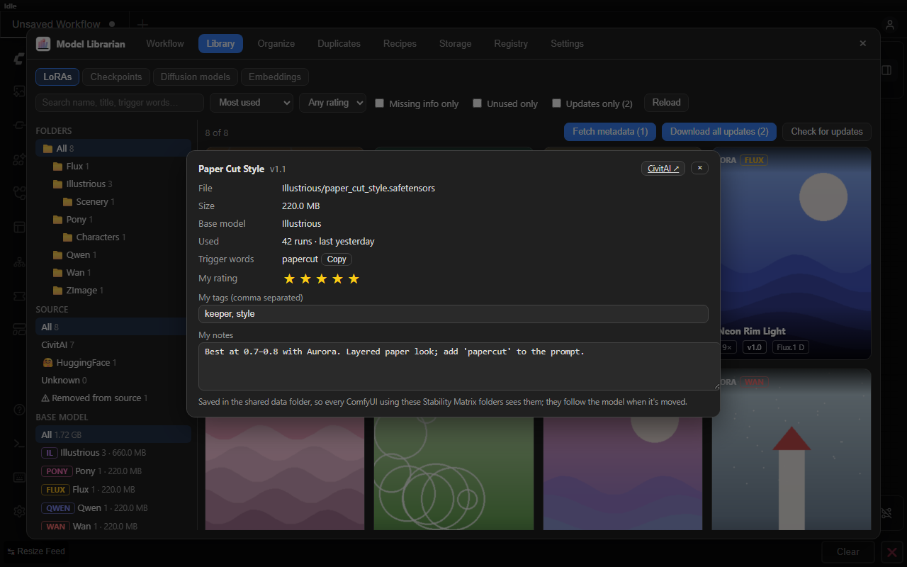 **Your notes** — most used first; rate a model, tag it and note what works | 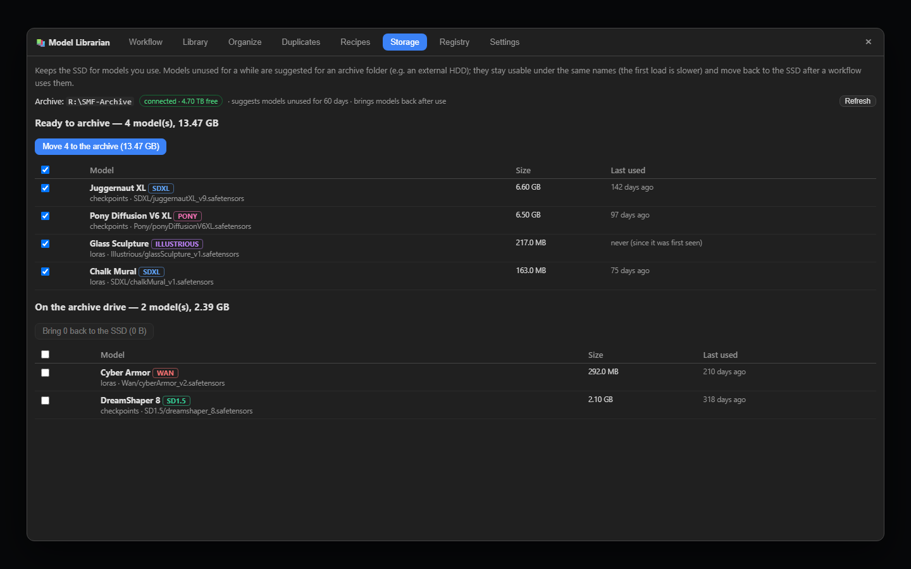 **Storage** — archive what you don't use, with a free-space goal for the SSD |
| 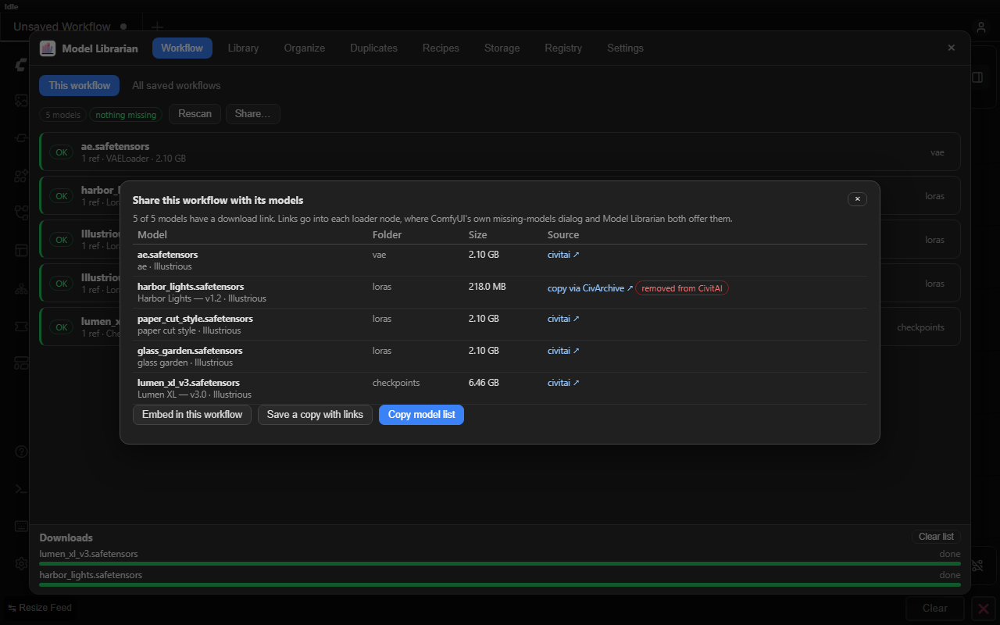 **Share** — a download link for every model, to embed in the workflow or post | 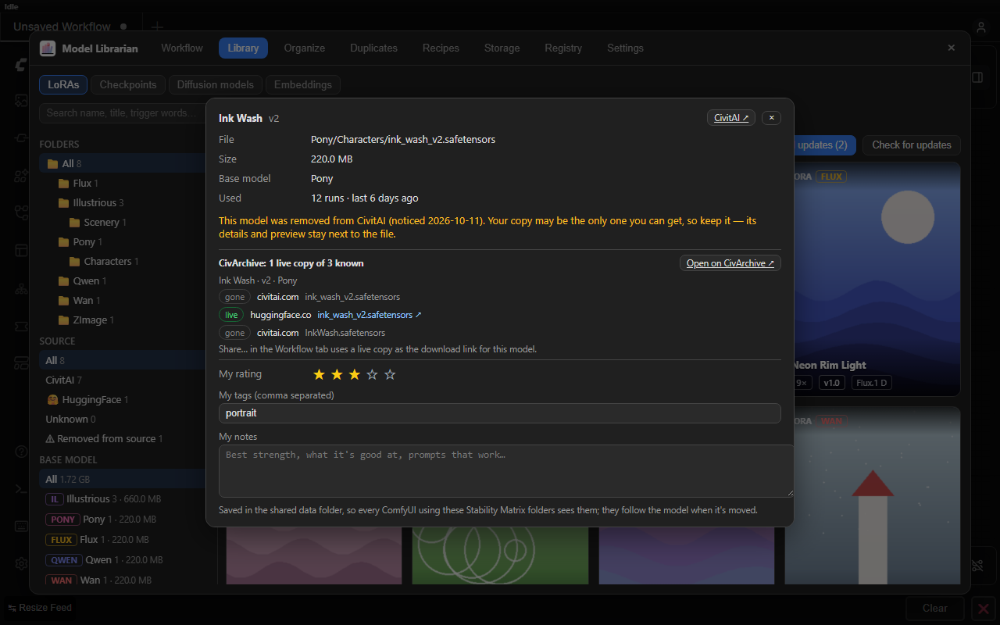 **Removed models** — marked in the Library, with CivArchive's surviving copies |
| 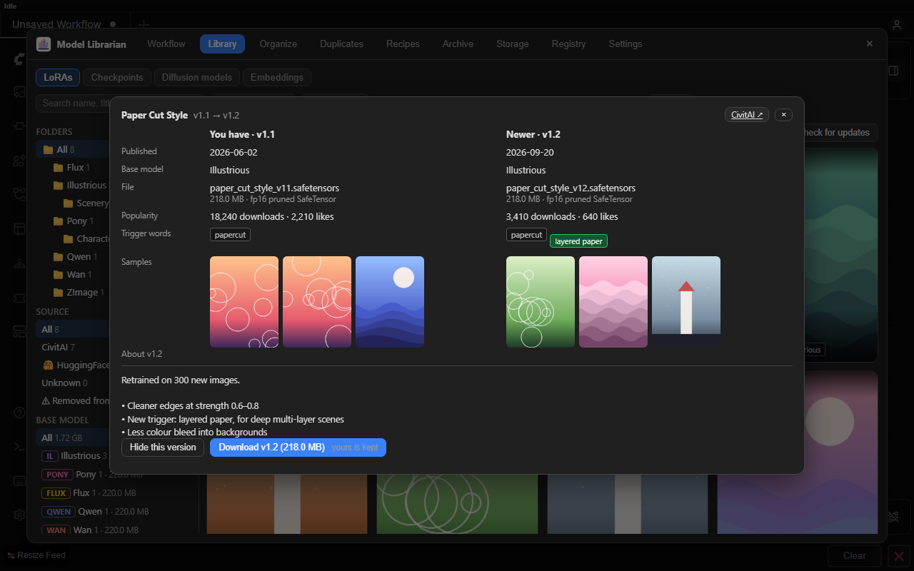 **Compare** — a new version next to yours before you download it | 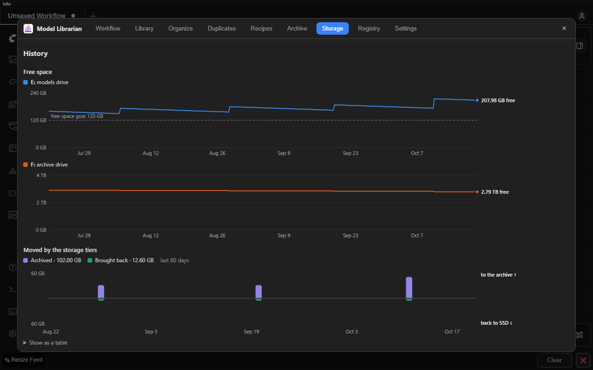 **History** — free space per drive over time, and what the tiers moved |
| 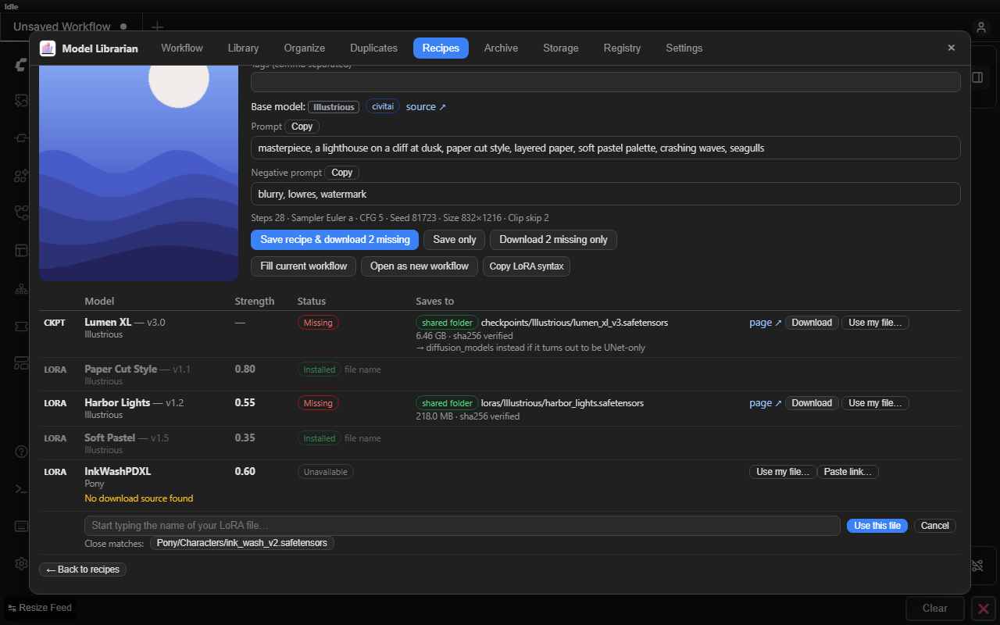 **Your file, another name** — link a recipe's model to the file you have, once | 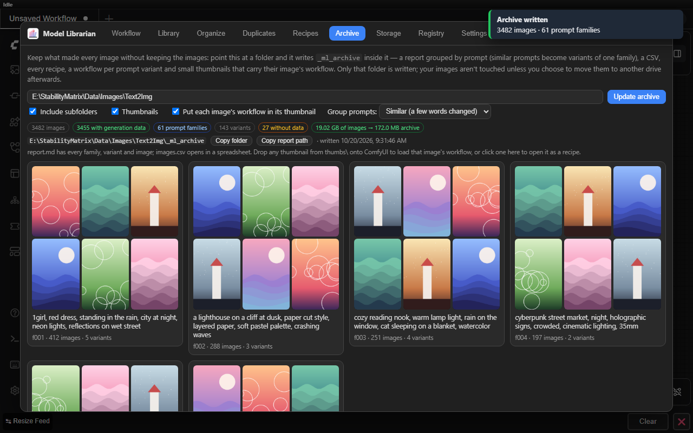 **Archive** — a folder of images as prompt families, with thumbnails that carry their workflow |

<sub>Screenshots and walkthroughs use sample data; they're rebuilt by <code>tools/readme_media/make_media.py</code>.</sub>

---

## 📦 Installation

### Option 1: **ComfyUI-Manager** (Recommended)

1. Open **ComfyUI** → **Manager** → **Custom Nodes Manager**.
2. Search for `Model Librarian`.
3. Click **Install** and restart ComfyUI.

### Option 2: **Comfy CLI**

```bash
comfy node install comfyui-model-librarian
```

### Option 3: **Manual Installation**

```bash
cd ComfyUI/custom_nodes
git clone https://github.com/EY4O/ComfyUI-Model-Librarian.git
```

No extra Python packages are needed. GGUF swaps use **ComfyUI-GGUF**, and LoRA Manager is optional — both available from ComfyUI-Manager.

<details>
<summary><b>Using it with Stability Matrix / Comfy Desktop</b></summary>

**Stability Matrix** packages are detected automatically (its `extra_model_paths.yaml` or symlinked model folders).

**Comfy Desktop**: the models folder set in its settings is used automatically, with ComfyUI's own folder names (`checkpoints`, `loras`, `diffusion_models`, …). If Model Librarian doesn't find your shared folder, set it in **Settings → Shared models and data** (per install).

**ComfyUI Desktop with Stability Matrix's folders** (Stability Matrix's own names: `StableDiffusion`, `Lora`, …) needs a section in its `extra_model_paths.yaml` pointing at Stability Matrix's models folder (change the path), then a restart:

```yaml
stability_matrix:
  base_path: C:/StabilityMatrix/Data/Models
  checkpoints: StableDiffusion
  diffusion_models: DiffusionModels
  loras: |
    Lora
    LyCORIS
  text_encoders: TextEncoders
  clip_vision: ClipVision
  vae: VAE
  controlnet: ControlNet
  upscale_models: ESRGAN
  embeddings: Embeddings
  ipadapter: IpAdapter
```

Any section whose paths look like `.../Models/<StableDiffusion|Lora|...>` is recognised, whatever its name.
</details>

## 🚀 Getting Started

1. **Settings** → add your CivitAI API key (and HuggingFace token).
2. Open a workflow — missing models show up as a notice; **Workflow → Find all sources → Download**.
   New to it? **Templates → comfyui-model-librarian** has four example workflows to start from.
3. **Library → Fetch metadata** to identify your existing models on CivitAI (previews, trigger words, base models).
4. **Organize → Build plan** to sort them into base-model folders.
5. Optional: set an archive folder in **Settings → Storage tiers** to start tiering.

---

## 📖 How It Works

<details>
<summary><b>🔗 Working with Stability Matrix and LoRA Manager</b></summary>

| | Owns | Model Librarian's part |
|---|---|---|
| **Stability Matrix** | Shared `Data/Models` folders, `.cm-info.json` + `.preview.*` sidecars | Downloads into SM's folders; writes SM's sidecars so models show as *connected* in its Checkpoint Manager; keeps its own data next to the models so every package shares it |
| **LoRA Manager** | LoRA library, `.metadata.json`, recipes, loader nodes | Reads LM's loader nodes (LoRA lists and `<lora:name:strength>` text); fills them when applying a recipe; mirrors saved recipes into LM's recipe list (optional); asks LM to rescan after downloads and moves; syncs metadata with SM's sidecars |

**Metadata sync** (Library → Sync with LoRA Manager) fills SM's `.cm-info.json` and preview from LM's metadata and vice versa, without any API calls. A new LM entry is only created when its SHA256 is verified, because LoRA Manager trusts that value.
</details>

<details>
<summary><b>🗂️ How the base model is detected</b></summary>

1. **CivitAI `baseModel`** — from SM / LM / `.civitai.info` metadata or a hash lookup. High confidence.
2. **LoRA training metadata** — `ss_sd_model_name`, `modelspec.architecture`, `ss_base_model_version`. This separates Illustrious, Pony and NoobAI from plain SDXL.
3. **Tensor layout** — read from the safetensors header (weights are never loaded): SD1.5/2/XL/3, Flux, Flux.2, Chroma, Qwen-Image, Wan, HunyuanVideo, LTXV, Lumina, Z-Image, Anima, HiDream and more. Medium confidence.
4. **File name** — low confidence; these moves start unchecked.

Models already in a matching family folder are left alone, and custom sub-folders are kept (`Characters/x` → `Illustrious/Characters/x`).
</details>

<details>
<summary><b>💾 SSD / HDD storage tiers</b></summary>

- **Usage tracking** — every queued prompt records which models it loads. Models never seen in a run count from when they were first seen, so nothing is suggested on day one.
- **Archiving (you approve)** — the Storage tab lists models unused for N days (60 by default). Each is copied to `<archive>/<SM folder>/<same path>`, the copy's SHA256 is verified, sidecars move with it, and only then is the SSD file removed. Runs can be undone from Organize → History.
- **Still usable** — archive folders are registered with ComfyUI, so archived models keep their exact names; workflows don't change, they just load more slowly. Use **Settings → Add archive folders to LoRA Manager** once so LM's loaders see them.
- **Coming back** — after a prompt uses an archived model, it's copied back to the SSD once the queue is idle. A different file is never deleted.
- **Free-space goal** — **Settings → Storage tiers → Keep free on the SSD**: when the drive holding your models has less free space than that, the Storage tab also suggests the least recently used models (oldest first) until archiving them would meet the goal, marked *for free-space goal*. Models used in the last 14 days (adjustable) are never suggested. If the goal can't be reached that way, it says so. You get one notice per session while the SSD is below the goal.
</details>

<details>
<summary><b>⭐ Your notes and most used</b></summary>

Click any model in the Library for its details: file, size, base model, trigger words, and how often it's been used (every queued prompt is counted). For checkpoints and diffusion models it also says how the file fits your GPU (VRAM, with room kept for the text encoder, and whether its format runs natively), what a diffusion model also needs (its text encoder and VAE, from ComfyUI's templates, with a Download button for missing ones) and, when it's a slow fit, **Find a better fit on CivitAI** among the model's other files. **About this model** shows the CivitAI description, saved next to the file when it's downloaded or identified (**Get it from CivitAI** for older ones), so it moves with the model and syncs with LoRA Manager. Rate it with up to five stars, give it your own tags and write notes — what strength works, what it's good at. They're kept in the shared data folder, so every ComfyUI using your models folder sees them, and they follow the model when Organize or the storage tiers move it. The Library sorts by folder, name, **most used**, recently used, your rating, size or newest file, filters by minimum rating, and its search covers your notes and tags.
</details>

<details>
<summary><b>🤗 HuggingFace details</b></summary>

Models downloaded from HuggingFace (through Model Librarian, so their source is known) get a **🤗 HF** chip in the Library with their license. Click it for the base model, task, likes and downloads, gating, tags and the start of the model card, cleaned up for reading, with a link to the repository. Details are fetched after the download and by **Fetch metadata**, cached for a week in the shared data folder, and can be refreshed from the popup. The Library's **Source** filter separates CivitAI, HuggingFace and unknown models.
</details>

<details>
<summary><b>🩺 Workflow health and update alerts</b></summary>

**Workflow → All saved workflows** reads every workflow and subgraph blueprint in ComfyUI's user folder, without opening them. Models are found in loader widgets, rgthree and LoRA Manager nodes, subgraphs and the sources embedded in a workflow; their folders come from each node's own inputs. The list shows the workflows that need something first; click one to see just its models, or **Open** it. **Find all sources** and **Download all** work as for the open workflow, and downloads keep the file name the workflows use, so they work without edits. **Fix moved paths** repoints saved files when exactly one file with that name exists (each file is backed up first). Models a node offers itself (frame-interpolation models it downloads on first use) aren't counted as missing.

Clicking the ⬆ chip compares the newer version with yours, side by side: dates, base model, file and size, downloads and likes, trigger words (new ones highlighted), sample images and what the author wrote about it. **Download** saves it next to yours; **Hide this version** stops the alert.

**Update alerts**: once a day (Settings → Behaviour), and from **Library → Check for updates**, each model with CivitAI metadata is looked up once per CivitAI model and cached for a day. A newer version counts only for the same base model and the same variant: a low-noise file isn't offered the high-noise version, and 4-step isn't an update of 8-step. Older copies kept next to a newer one aren't flagged. The ⬆ chip on a card downloads the new version next to the old one (with a version suffix if the author reused the file name); its × hides that version. **Download all updates** gets every flagged model in a section after one confirmation with the total size. Once updates finish, the Library offers to move the versions they replaced to the archive drive, where they stay usable.
</details>

<details>
<summary><b>📤 Sharing, removed models and CivArchive</b></summary>

**Workflow → Share…** looks up every installed model the open workflow uses: your download history, then the CivitAI version recorded next to the file, then CivitAI by SHA256. Each link goes into its loader node as ComfyUI's own `properties.models` (LoRA Manager LoRAs on their LoRA Manager node), so whoever opens the workflow gets download buttons from ComfyUI's missing-models dialog, or from Model Librarian with the hash checked. **Embed in this workflow** changes the open workflow (save it afterwards), **Save a copy with links** downloads a copy and leaves yours alone, and **Copy model list** gives a Markdown list with pages, sizes and hashes to post next to it.

**Removed models**: the daily update check also notices when CivitAI no longer lists a model, or the version you have, and HuggingFace details notice deleted repositories. The Library marks them with **Removed**, the **Source** list filters them, and a notice says when it happens. Nothing is deleted; keep them, since they can't be downloaded again from there.

**[CivArchive](https://civarchive.com)** indexes copies of models by SHA256 (CivitAI re-uploads, HuggingFace mirrors and other hosts) and remembers the CivitAI details of removed ones. Model Librarian only asks it about files CivitAI doesn't have: the missing-model finder when nothing else found the file, **Fetch metadata** when CivitAI answers "not found" (the details are written next to the file as usual), **Share…** for removed models, and the **Find copies on CivArchive** button in a model's details. Live copies on CivitAI or HuggingFace download like any source, SHA256-verified; copies on other hosts are links you open yourself. Lookups are cached in the shared data folder, and **Settings → Behaviour** turns CivArchive off.
</details>

<details>
<summary><b>📈 Storage history</b></summary>

**Storage → History** charts the free space on the drive with your models and on the archive drive over the last 90 days, with the free-space goal as a line, and below it how much the storage tiers moved to the archive and back each day. A sample is taken every 6 hours while any ComfyUI sharing the data folder runs, kept for a year in `storage_history.json`; hover for the numbers, or open the table view.
</details>

<details>
<summary><b>🗃️ Archive</b></summary>

**Archive** reads the generation data of every image and video in a folder and its subfolders (ComfyUI, A1111/Forge, CivitAI and the other formats Recipes reads) and writes `_ml_archive/` inside that folder. Nothing else in the folder is changed unless you move the originals (below).

| File | What's in it |
|---|---|
| `report.md` | Prompt families → variants → one row per image. Settings every image in a variant shares are listed once; the table only has the columns that differ (seed, model, …). A variant shows what it changed against the family's base prompt: `+ umbrella` `− city at night`, or `playing guitar` → `reading a book`. |
| `images.csv` | One row per image: prompt, negative, seed, model and hash, LoRAs with strengths, sampler, scheduler, steps, CFG, size, denoise, VAE, date, thumbnail and workflow. |
| `recipes.jsonl` | The full recipe of every image in the shared [recipe/1 format](docs/RECIPE_FORMAT.md). |
| `workflows/` | One ComfyUI workflow per prompt variant. |
| `thumbs/` | A 512 px WebP per image or video (its first frame; about 20 KB, about 50 KB with the workflow) carrying that file's ComfyUI workflow and prompt, its recipe and any A1111 text. Drop one onto ComfyUI and it opens that exact image's workflow, seed included. In the tab, click a thumbnail to open it in **Recipes**. |
| `moves/` | A log of every move of the originals, for **Undo**. |

**Group prompts** decides what counts as one family: *Similar* (the default: prompts that share most of their phrases or words), *Loose*, or *Exact only*. LoRA tags and `(word:1.2)` weights are ignored when comparing. Images without generation data are listed at the end of the report.

The first run reads every file (four at a time); later runs only read new or changed files and drop the thumbnails of deleted ones, so you can archive a folder you keep adding to. A cancelled run carries on where it stopped.

**Move the originals to another drive…** (under the results) frees the space the images take while keeping them: archived files move to the folder you choose (it starts as `<archive drive>\outputs\<folder name>` when an archive drive is set in **Settings**), keeping their subfolders and dates. **Check** shows what would move first; files changed since the archive was written, changed in the last 10 minutes (ComfyUI may still be writing them) or already at the destination stay where they are. Across drives each file is copied, its size checked, and only then removed. Moved files stay in the archive with their thumbnails, and later runs don't read them again. Every move is logged in `_ml_archive/moves/`, and **Undo** puts the files back.

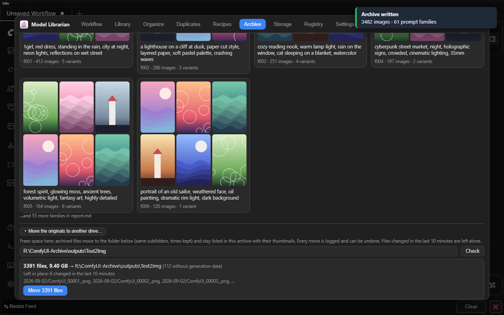
</details>

<details>
<summary><b>🧬 Recipes</b></summary>

Model Librarian reads the generation data itself — PNG text chunks, JPEG/WebP EXIF, ComfyUI videos (Save Video and Save WEBM, Video Helper Suite's MP4/WebM, animated WebP), ComfyUI graphs (including Flux-style custom samplers, rgthree and LoRA Manager loaders), A1111/Forge text with its hashes, CivitAI's image API, Fooocus, InvokeAI, SwarmUI and NovelAI. A CivitAI post link shows its images to choose from.

- **From your own runs** — right-click a Save Image or Preview Image node after a run for **Save last image as recipe** (a batch lets you pick the image), or use **Last run** in the Workflow tab, which shows the newest images this workflow made. The recipe is read from what made the image: its embedded data, or, for an image saved without it, ComfyUI's record of that run, so it matches the picture even if you've changed the workflow since. It's named after the workflow and the prompt. It keeps a 512 px picture and links to the image in your output folder (**full image ↗**); tick **Keep a full-size copy** when saving to keep the image itself with the recipe.
- **Library** — saved recipes live in the shared data folder (`recipes/`), so every ComfyUI using your models folder sees them. Filter, favourite, rename, tag; deleting moves them to `recipes/_deleted/`. **Refresh picture** fetches a recipe's picture again from the link it was saved from (a CivitAI image page or an image link); the old picture is kept in `recipes/_deleted/`.
- **Your files** — models you already have are matched by hash, file name, the name the image uses, or a similar name (case, punctuation and a version suffix ignored: `ILFF7Tifa` finds `ILFF7_Tifa_v2`). When it can't tell, **Use my file…** links the model to a file you pick and **Paste link…** takes the page or download link where it's found; both are remembered, so the next recipe naming it resolves on its own.
- **Download** — each model's exact CivitAI file is found by version ID or hash and saved into the matching base-model folder. "Checkpoints" that turn out to be UNet-only go to `DiffusionModels`. Models found only by file-name search are never bulk-downloaded.
- **Fill current workflow** — sets the prompts, seed, steps, CFG, sampler, scheduler, size, clip skip, model and LoRAs in the workflow that's open. LoRA Manager's loader gets the whole list; plain LoRA loaders are filled in order, extra ones are added to the chain, and unused ones are bypassed.
- **Open as new workflow** — opens the ComfyUI workflow saved in the image, or builds a simple text-to-image workflow for checkpoint models.
- **LoRA Manager** — with it installed, new recipes are also saved to LM's recipe list (**Settings → Behaviour**), and LM's own recipes appear under yours, read-only: open one to download its models, fill a workflow or save a copy. Recipes already mirrored from Model Librarian aren't shown twice.

- **Model Librarian Gallery** — with **Recipes** on in the Gallery's Settings, it shows this same list (the shared `recipes/` folder) and brings recipes in from its pictures, recipe files and CivitAI links; **Open in Model Librarian** there opens one here in the Recipes tab (1.29.0+), ready to download what's missing and fill the workflow.

The format is documented in **[docs/RECIPE_FORMAT.md](docs/RECIPE_FORMAT.md)**. Dropping an image on the window never replaces your open workflow.
</details>

<details>
<summary><b>🎚️ LoRAs: trigger words and strengths</b></summary>

The **Workflow** tab lists the LoRAs you have in the open workflow (plain LoRA loaders and LoRA Manager's).

- **Trigger words** — from the LoRA's CivitAI, Stability Matrix or LoRA Manager metadata. The positive prompt is found by following each sampler's `positive` input back to the text that feeds it (through String and concatenate nodes too); words already in it are ticked, missing ones are highlighted. Click one, or **Add all**, to put them in front of the prompt, in one Ctrl+Z step. **Copy** gives the list for anywhere else.
- **Compare strengths…** — type the strengths (`0, 0.4, 0.7, 1` to start with) and **Build comparison**: a new workflow opens where everything after that LoRA's loader is copied once per strength, with the same prompt and seed (set to fixed), laid out by Rebuild from connections. Each copy saves its images with the strength in the name (`_lora0.7`). Your own workflow isn't changed. A saved recipe has the same button, for any of its LoRAs.
</details>

<details>
<summary><b>🧹 Arrange: tidy or rebuild a layout</b></summary>

Right-click the canvas and open **Arrange workflow**, or **Arrange N selected nodes** when two or more are selected (then only those move). The same four options are under **Arrange…** in the Workflow tab and in the command palette (`Arrange workflow: …`), where you can give them keys in ComfyUI's keybinding settings.

| Option | What it does |
|---|---|
| **Tidy in place** | Lines up and spaces the nodes roughly where they are. |
| **Tidy and pull in stragglers** | The same, but nodes far from what they connect to are brought in beside it. |
| **Rebuild from connections** | Lays everything out again from the wires, left to right, ignoring where nodes are now. Shows the new layout first. |
| **Rebuild, shared models first** | The same, with the models several stages use (checkpoint, CLIP, VAE) kept together at the top-left. |

**Tidy in place** is gentle: nodes stay roughly where you put them.

- Nodes are sorted into the columns they're already in; columns get one left edge and even spacing, and gaps of more than a few node-widths are closed.
- In a column, nodes are stacked without overlaps and spread-out ones are pulled together; a node that feeds another in the same column goes above it, so wires run downwards.
- A node is lined up with what feeds it (straighter wires) when that's within a short distance of where it was, and a stray node with nothing feeding it (an Empty Latent far away) is drawn towards the one node it feeds.
- Groups stay blocks: their nodes are tidied inside, the group fits around them, and groups (nested ones too) are arranged like nodes without overlapping. Pinned nodes never move; others make room. Inside a subgraph, it tidies that subgraph.
- Only positions change, never sizes, wires or settings, and one Ctrl+Z puts everything back. Tidying a tidy workflow changes nothing.

| Before | After |
|:---:|:---:|
| 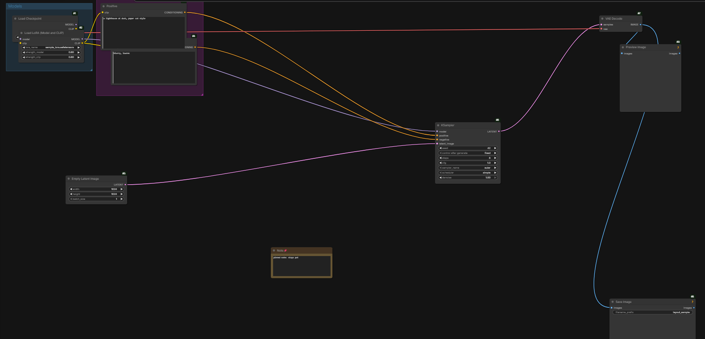 | 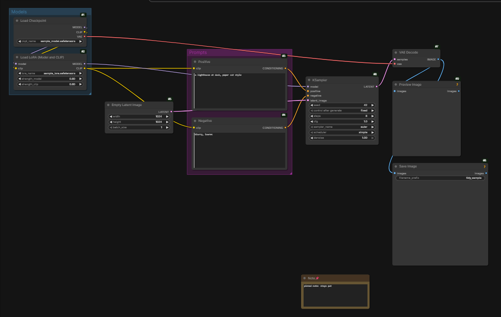 |

<sub>A sample workflow on ComfyUI's own canvas.</sub>

**Tidy and pull in stragglers** works the same way without the distance limit: every node is lined up with what feeds it however far away it was, so far-flung nodes come in.

**Rebuild from connections** ignores where nodes are and lays the workflow out again from its connections (on a selection, just those nodes, where they are). **Rebuild, shared models first** keeps the loaders used in more than one place (a checkpoint, CLIP or VAE feeding several stages) stacked together at the top-left, while a loader used once still sits just before what it feeds.

- Each node goes in a column after everything that feeds it, so every wire runs left to right; each node sits just before the first thing it feeds, so loaders, empty latents and side branches aren't left out at the far left.
- Set/Get nodes (KJNodes, Easy-Use) count as connected: a Get comes after its Set and just before what it feeds, and the workflow stays one piece.
- Nodes in a column are ordered to cross as few wires as possible and lined up with their connections, and the whole thing keeps its top-left corner.
- Groups stay blocks around their own nodes and are placed by what they connect to; separate pieces of a workflow are laid out on their own and stacked. Pinned nodes, and the groups they're in, stay put and the layout keeps clear of them; notes and other unconnected nodes keep their place beside their nearest neighbour.
- Nothing moves until you say so: the new layout is drawn over the dimmed canvas (the nodes that would move outlined in blue), zoomed to fit, with **Apply** and **Cancel** (or Esc) at the bottom. Apply moves everything as shown, in one Ctrl+Z step; Cancel puts your view back. Rebuilding a rebuilt workflow finds nothing to do.

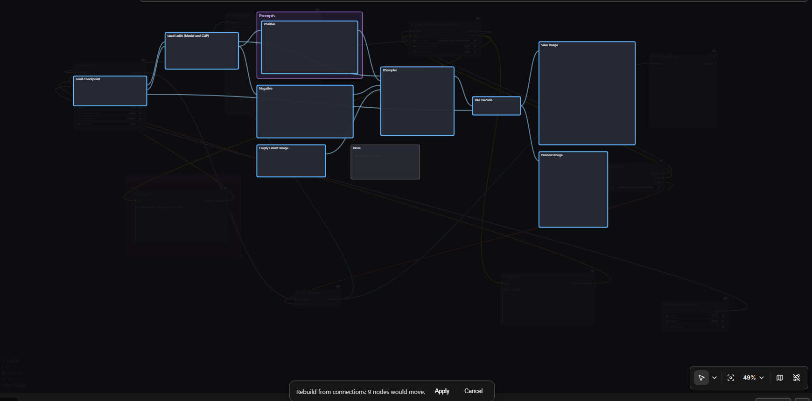

| Before | After Rebuild from connections |
|:---:|:---:|
| 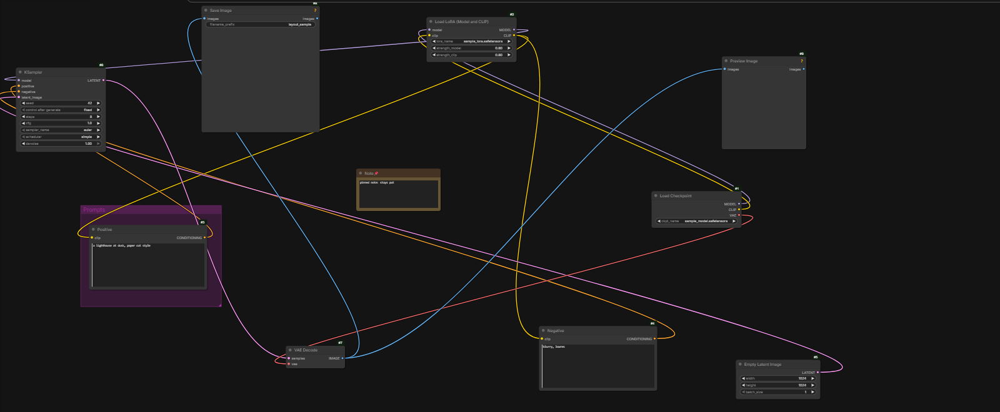 | 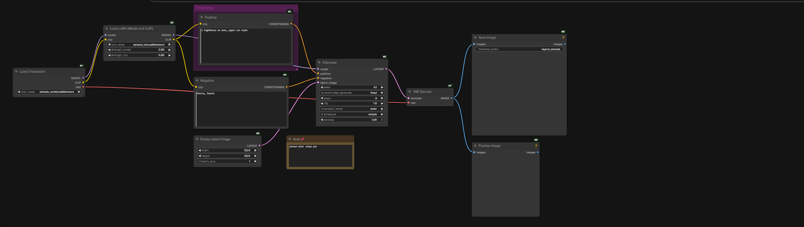 |
</details>

<details>
<summary><b>🏷️ Gallery Info: sort images as they're made</b></summary>

Add **Gallery Info (Model Librarian)** (under **Model Librarian** in the node list) just before your save node: images in, the same images out. Fill in any of **albums**, **tags**, **characters** (several separated by commas), **project**, **rating**, **favourite** and **note**; each can also be wired from another node, such as a wildcard, so it matches what was generated.

- **Where it goes:** ComfyUI hands every save node the same metadata, and each writes all of it into the file. So Save Image, Save Video, Save WEBM and Video Combine (Video Helper Suite) all store the node's entry next to the prompt and workflow, with no special save node.
- **What it adds by itself:** the checkpoint and LoRAs that ran, with their strengths and the hashes Model Librarian already knows (nothing is hashed during the run), the open workflow's name and Model Librarian's version.
- **Folders:** **folder_pattern** builds the `filename_prefix` output from `{project}`, `{character}`, `{characters}`, `{album}`, `{tag}`, `{model}`, `{rating}`, `{date}`, `{year}`, `{month}` and `{day}`. Wire it into the save node's **filename_prefix**, and each file lands in its folder as it's saved. A placeholder with no value drops its folder; names are cleaned of characters Windows refuses, and can't leave the output folder.
- **In the Gallery:** albums and tags are added as "from the workflow", characters count as confirmed, and the rating and favourite apply unless you've set your own there.
- ComfyUI started with `--disable-metadata` writes no metadata at all, this entry included.
- **Open in ComfyUI** (in the Gallery) sends a file's workflow to Model Librarian, which opens it in a new tab in the ComfyUI page you have open (one tab, even with several pages open). Nothing is queued.
</details>

<details>
<summary><b>👤 Character Select: your characters as prompt tags</b></summary>

Add **Character Select (Model Librarian)** (under **Model Librarian** in the node list). Your characters come from the Model Librarian Chrome extension's **+ Character** on Danbooru, Gelbooru, Safebooru and e621: each has its booru tag, its series, appearance tags (hair, eyes and the like) and outfits. A character from a post can also be linked to one you made yourself (1.27.0+, extension 0.9.0): it gets the tag and the post's look, and keeps your name; one of yours with the same name in either order and no tag is linked by itself.

- **Pick one:** click the character on the node for a list of your characters with their pictures; type to search by name, series or tag (the arrow keys and Enter work too). Pick an **outfit** under it.
- **Leave tags out:** the tags the node will write are shown on it; click one to leave it out (it's struck through), click again to put it back. **include_character**, **include_series**, **include_appearance** and **include_outfit** switch whole parts off or on (the series is off to start with).
- **prompt:** the tags with spaces and the brackets escaped (`aurelia \(lighthouse tales\), silver hair, …`), so ComfyUI doesn't read them as weights. Wire text into **before** (quality tags, say) and **after** (the scene) to have one prompt out.
- **character:** the character's name: wire it into Gallery Info's **characters**, so the Gallery counts it as confirmed (and `{character}` in its folder pattern uses it).
- **LoRA:** wire **model** and **clip** through the node. When the character has a LoRA, it's loaded at **lora_strength** and its trigger words go first in the prompt; without one, they pass through unchanged.
- **Linking a LoRA to a character:** click **LoRA** on the node and pick one of your LoRAs (or **No LoRA**), or use 👤 on a LoRA's card in the **Library** (or **Use for character…** in its details) and pick the character. Its trigger words come from the LoRA's metadata (CivitAI's, Stability Matrix's or LoRA Manager's); edit them on the character's page in Model Librarian Gallery. The Chrome extension can link one from its CivitAI page too.
- **Random:** **random_character** picks one of your characters each run, **random_outfit** one of the character's outfits, both drawn from **seed** (the same seed, the same pick). The seed changes after each run only while something is random; otherwise it stays put, so ComfyUI reuses the node's result instead of running it (and what follows) again. With a random character, each one's own first outfit and LoRA are used.
- The node reads the character when the workflow runs, so a change to it shows in the next run. A character that's no longer in your list stops the run with a message saying so.
- The list is `characters.json` in Model Librarian's data folder, shared with Model Librarian Gallery.
</details>

<details>
<summary><b>🧩 Impact Pack switch nodes</b></summary>

On current ComfyUI frontends, a workflow with one of ComfyUI-Impact-Pack's switch or list nodes (`ImpactSwitch`, `ImpactMakeImageList`, `LatentSwitch` …) wired into its first input stops loading with *Loading aborted due to error reloading workflow data — TypeError: t.findInputSlot is not a function*, whether it's dropped in, opened from the Gallery or switched to in a tab. Impact Pack's check for "a workflow is loading" no longer finds the loader in the shortened stack trace, so its node rewires itself mid-load ([#1223](https://github.com/ltdrdata/ComfyUI-Impact-Pack/issues/1223), [#1244](https://github.com/ltdrdata/ComfyUI-Impact-Pack/issues/1244)). Until Impact Pack ships a fix, Model Librarian keeps a longer stack trace while a workflow loads, so the node is left as it was saved, and turns the bad connect call into a no-op. Nothing else changes, and without Impact Pack it never comes into play.
</details>

<details>
<summary><b>🛡️ Safety</b></summary>

- Downloads are verified against the source's SHA256 and resume after interruptions; credentials only go to their own service, never to CDN redirect hosts.
- Moves never overwrite; a model ComfyUI has loaded is skipped; every run can be undone; moves never run alongside metadata fetches or duplicate scans.
- Duplicates are quarantined or hard-linked, never deleted — hard links only when size, timestamp and sampled bytes still match.
- Saved workflows are backed up before they're repointed. API keys stay in each install's user folder, never in the shared data folder.
</details>

<details>
<summary><b>🔍 What it does on disk and online</b></summary>

So you know exactly what you're installing:

- **Online:** it talks to CivitAI and HuggingFace (model details, previews, downloads, update checks), reads ComfyUI-Manager's public model list from GitHub, and asks CivArchive about files CivitAI doesn't have (can be turned off). Downloads only start when you click; the update check runs once a day and can be turned off in **Settings**. API keys are only sent to the service they belong to.
- **On disk:** it writes models into your model folders, moves files when you run Organize or the storage tiers, and keeps its own data (registry, hash cache, recipes, notes, settings) in the shared data folder. Duplicate copies are hard-linked only when you click **Replace with hard links** and confirm, and leftover downloads are deleted only when you tick them and confirm.
- **Never:** it doesn't run downloaded code, install packages, execute other programs or send your files or library anywhere. Everything is plain Python and JavaScript in this repository.
</details>

<details>
<summary><b>🤝 Shared data</b></summary>

With a shared models folder found (Stability Matrix's or Comfy Desktop's), the registry, hash cache, undo history, usage data, recipes and settings live in `.sm_model_fetcher/` inside it, shared by every ComfyUI that uses that folder (several can run at once). Turn it off in **Settings → Shared models and data**.

*Formerly **SM Model Fetcher** — internal names are unchanged, so existing data carries over.*
</details>

---

## 🧪 Development

Tests, the safe installer and the publishing workflow are described in **[docs/DEVELOPMENT.md](docs/DEVELOPMENT.md)**.

## 🤝 Contributing

Issues and pull requests are welcome — please run the test suite before opening a PR.

## 🙏 Credits

- [Stability Matrix](https://github.com/LykosAI/StabilityMatrix) — shared model folders and the `.cm-info.json` format
- [LoRA Manager](https://github.com/willmiao/ComfyUI-Lora-Manager) — recipes, metadata and loader nodes this integrates with
- [ComfyUI-GGUF](https://github.com/city96/ComfyUI-GGUF) and city96's GGUF quantizations
- [ComfyUI-Manager](https://github.com/Comfy-Org/ComfyUI-Manager)'s model list, and the CivitAI and HuggingFace APIs

## ☕ Support

If Model Librarian saves you time (or disk space), you can support its development:

[](https://ko-fi.com/looneth)

## 📄 License

[MIT](LICENSE)
